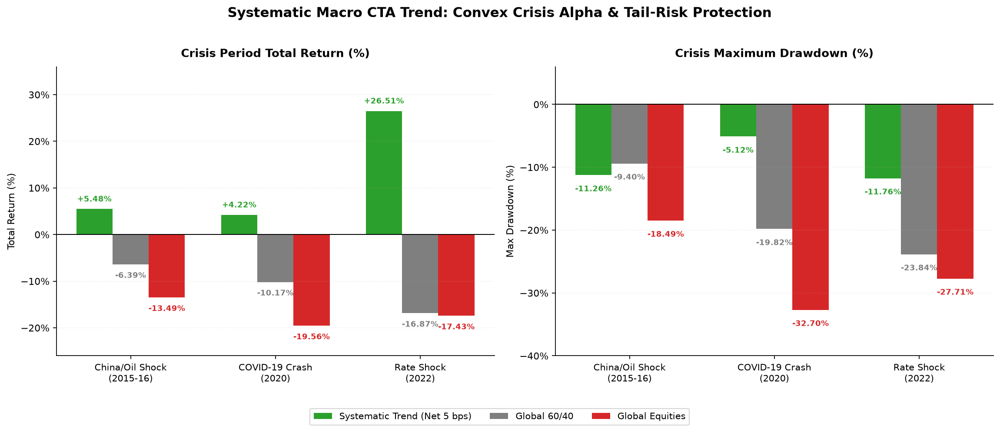
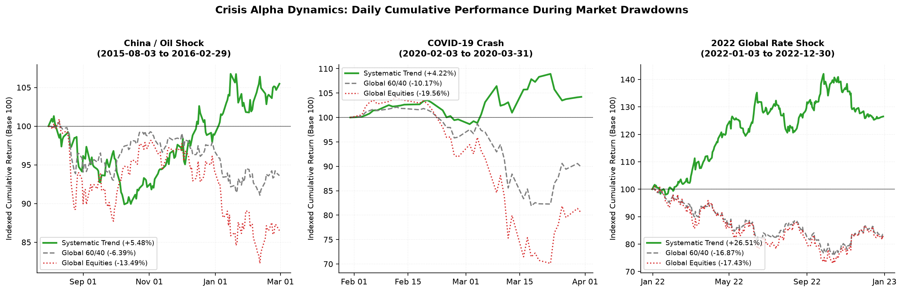

# Systematic Macro CTA: Multi-Asset Trend Following Across Regimes

Fixed-rule multi-horizon trend-following research across `22` liquid US-listed ETF proxies spanning equities, sovereign bonds, FX, and commodities (`2015-06-05` to `2024-12-31`, `2,410` trading sessions).

Trend-following strategies carry a classic empirical trade-off: modest full-sample standalone Sharpe ratios during prolonged low-volatility bull markets and sideways rate regimes (`2016–2019`, `2023–2024`), paired with strong trend capture during sustained macro dislocations (`2015–2016`, `Feb–Mar 2020`, `2022`).

## Full-Sample Performance (`2015-06-05` – `2024-12-31`, 2,410 Days)

Over the complete 9.6-year sample, standalone returns are modest after `5 bps` transaction costs because range-bound markets generate frequent crossover whipsaws:

| Signal Cadence | Cost Assumption | Total Return | CAGR | Annual Vol | Sharpe | Max Drawdown | Annual Turnover |
|:---|:---|---:|---:|---:|---:|---:|---:|
| **Daily expanding** | 0 bps (Gross) | +85.62% | +6.68% | 13.55% | 0.55 | -20.31% | 40.2x NAV |
| **Daily expanding** | **5 bps (Net)** | **+53.20%** | **+4.56%** | **13.55%** | **0.40** | **-22.51%** | **40.1x NAV** |
| **Monthly rolling (21d signal)** | 0 bps (Gross) | +80.85% | +6.39% | 13.77% | 0.52 | -20.23% | 23.8x NAV |
| **Monthly rolling (21d signal)** | **5 bps (Net)** | **+61.40%** | **+5.13%** | **13.78%** | **0.43** | **-21.60%** | **23.8x NAV** |

- **Turnover Dampening:** Freezing directional signal signs on a 21-day cadence (`Monthly rolling`) while keeping daily volatility targeting cuts annual turnover from 40.1x to 23.8x NAV, raising net full-sample Sharpe from 0.40 to 0.43 (+5.13% vs. +4.56% net CAGR).
- **Whipsaw & Non-Monotonic Stress Regimes:** During shorter equity pullbacks where trend signals lag or reverse quickly (e.g., Q4 2018), trend-following does not guarantee positive returns; its value lies in sustained directional repricing rather than all short-term dips.

All full-sample rows are logged in [metrics.csv](artifacts/metrics.csv) and [scores.csv](artifacts/scores.csv).

## Behavior During Selected Stress Episodes & 2020–2022 Cycle

Across the three selected macro dislocation episodes where persistent directional moves occurred across rates, commodities, or equities, the daily model delivered positive net returns:

| Selected Episode | Start | End | Daily Trend (Net 5 bps) | Daily Trend (Gross) | Global 60/40 | Equity Basket |
|:---|---:|---:|---:|---:|---:|---:|
| **China / Oil Shock** | 2015-08-03 | 2016-02-29 | **+5.48%** | +7.00% | -6.39% | -13.49% |
| **COVID-19 Crash** | 2020-02-03 | 2020-03-31 | **+4.22%** | +4.79% | -10.17% | -19.56% |
| **2022 Global Rate Shock** | 2022-01-03 | 2022-12-30 | **+26.51%** | +28.38% | -16.87% | -17.43% |

During February–March 2020, strategy drawdown was `-5.12%` vs. `-32.70%` for the equity basket and `-19.82%` for Global 60/40. Across the 3-year 2020–2022 cycle (`2020-01-01` – `2022-12-31`), daily trend compounded **+48.87% Net** (+57.10% Gross, +14.18% Net CAGR, **0.96 Net Sharpe**, -11.76% Max DD) vs. +11.30% (0.27 Sharpe, -32.70% Max DD) for global equities and +3.26% (0.15 Sharpe, -24.30% Max DD) for 60/40. Monthly rolling over 2020–2022 returned +39.78% Net (0.81 Sharpe, -12.02% Max DD).





## Signal Architecture & Staged Risk Scaling

1. **Multi-Horizon Trend Signals:** From cumulative daily log returns $y_{i,t} = \sum_{\tau=1}^t r_{i,\tau}$ and 63-day EWMA volatility $\sigma_{i,t}$, three EMA crossovers (`16/64`, `32/128`, `64/256` days, weights `[0.25, 0.35, 0.20]`) are standardized by $\sigma_{i,t}\sqrt{S_k^{\mathrm{fast}}}$ and blended with 126-day log-momentum (`0.20` weight), clipped to $[-2.5, +2.5]$.
2. **Instrument & Portfolio Volatility Targeting:**
   $$w_{i,t}^{(1)} = \mathrm{clip}\left(S_{i,t} \cdot \frac{0.15}{\sigma_{i,t}\sqrt{252}}, \, -3.0, \, +3.0\right)$$
   Weights are capped at aggregate gross leverage $L_{\max} = 3.0$, scaled by a lagged 63-day portfolio volatility multiplier $\kappa_t = \mathrm{clip}(0.15 / \sigma_{\mathrm{port}, t-1}, 0.1, 3.0)$, and re-capped to $[-3.0, +3.0]$ per asset and $3.0\times$ NAV overall.
3. **Self-Financing Drift Accounting:** Targets lag close $t$ by one day (`t -> t+1`). Simple arithmetic returns drive NAV updates, and iterative rebalancing solves exact `5 bps` transaction fees against drifted weights $w_{i,t-1}^{\mathrm{drift}} = w_{i,t-1} e^{r_{i,t-1}} / (1 + R_{p,t-1})$.

## Reproducibility & Data Snapshot

```bash
git clone https://github.com/Juliansaiani/systematic-macro-cta.git
cd systematic-macro-cta
python -m pip install -r requirements.txt
python -m pip install -e '.[dev]'
python -m pytest -q
python -m macro_cta.pipeline --verify
# Optional: fetch fresh Yahoo Finance closes into git-ignored data/cache/
python -m macro_cta.pipeline --refresh
```

By default, `--verify` reads the tracked adjusted-price snapshot in `data/snapshot/` so retroactive Yahoo Finance split/dividend updates do not break deterministic regression assertions. Interactive diagnostics are in [notebooks/research.ipynb](notebooks/research.ipynb).

## Methodological Limits & Release Note

- **ETF Proxies vs. Futures:** Modeling `22` US-listed ETFs (`SPY`, `TLT`, `GLD`, `USO`, etc.) up to `3.0x` gross leverage omits real margin financing, short-borrow fees, and ETF tracking drag that would not apply identically to unfunded exchange-traded futures.
- **Close-Mark Execution:** Signals assume execution at closing marks with a flat `5 bps` turnover fee, abstracting from intraday slippage and cross-time-zone settlement differences.
- **Release Timeline:** Research conducted in 2025; packaged with deterministic snapshot verification and published in 2026. MIT License — Copyright (c) 2025 Julian Saiani.
